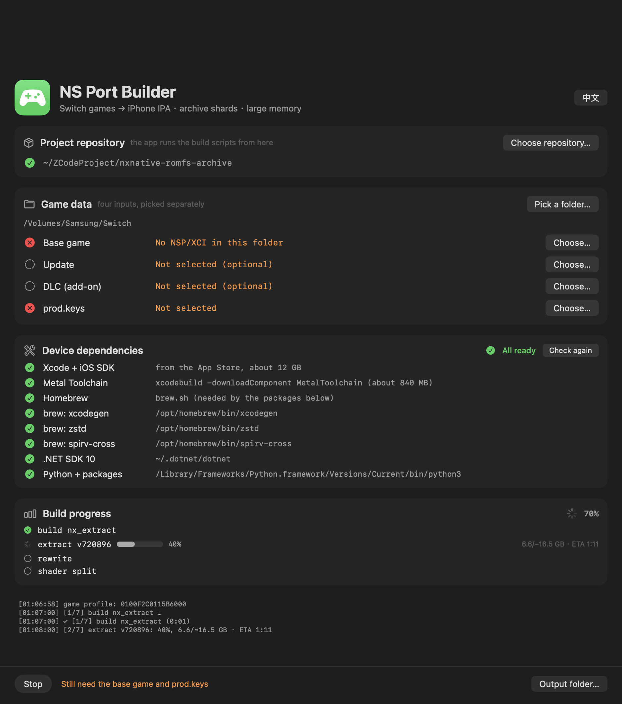

# NS Port Builder v0.4.0 — release notes

This is the text of the [v0.4.0 release](https://github.com/LNPANDY/NX2Apple/releases/tag/v0.4.0). Earlier releases (v0.3.x, v0.2.x, v0.1.0) are on the releases page; their links redirect through the rename. 中文说明在英文下方。

Three releases in one: a GUI that carries a first-time user from NSPs to a working install, an automated link to upstream, and the recovery of two features a sync had silently dropped.

Screenshot (click to expand)

## New: the archive folder is ready to copy, with an install guide

The shards now land in a **`romfs/` folder** — `romfs.idx` plus the shards — next to the NSPs. That is exactly the layout the game app's `Documents/romfs` wants, so the folder is copied onto the phone **without renaming**. A previous pack's shards are cleared first, so a smaller new pack never leaves stale files behind.

When the build finishes, the window gains an **"安装到 iPhone"** group: the three steps (install the IPA with AltStore / Sideloadly → copy the whole `romfs` folder into the game app's Documents through the Files app → launch), the IPA and folder paths, and a Reveal-in-Finder button for each — no more digging through directories.

## New: the dependency list collapses

The eight dependency rows only matter while setting a machine up. The section is now a disclosure: collapsed automatically once everything is green, open while something is missing, and your manual choice is remembered.

## New: the README lists each game's required update version

The build checks the update NSP's display version against the profile's registered build, so the games table now has an **"Update required" column** — the exact version each game needs (e.g. Tears of the Kingdom `1.4.3`, Mario Kart 8 Deluxe `4.0.0`), with "无（v0）" for games that need no update.

## The repository is now NX2Apple

Renamed from `nxnative-romfs-archive` — old links redirect automatically. The README opening was rewritten around what the project has become, and the legal section was substantially expanded (what the project contains and what it cannot do, trademarks, user responsibility, takedowns, no warranty).

## Also since v0.3.1

- **48 games** (up from 46): Mario Kart 8 Deluxe and Balatro, plus the upstream host work behind them.
- **One translation chain version** for every game (upstream's fix for issue #78): the stale-header failure that stopped the first Animal Crossing build can no longer happen.
- **The automated upstream sync** (`.github/workflows/sync-upstream.yml`, daily): re-applies the fork's features onto upstream's tree, verifies (Python 3.9 parse, archive reader test, macOS host build), pushes — or opens an issue with the log. The replay tests caught and recovered two features the earlier wholesale sync had dropped: `romfs.idx` recognition and the Hades II update support.

## What this build is

[`NS-Port-Builder-macOS-arm64.zip`](https://github.com/LNPANDY/NX2Apple/releases/download/v0.4.0/NS-Port-Builder-macOS-arm64.zip) — the app itself, ad-hoc signed, Apple Silicon, macOS 13+. Unzip, then right-click → Open on first launch (or `xattr -dr com.apple.quarantine "NS Port Builder.app"`).

**This is a front end only.** It drives the scripts of [NX2Apple](https://github.com/LNPANDY/NX2Apple), so clone that repository on the same Mac; the app finds it automatically and otherwise you pick it once with Choose repository….

## Verified games

| Game | Update required | Status |
|---|---|---|
| **Tears of the Kingdom** | 1.4.3 (v720896) | Verified — builds, installs and runs on an iPhone; 304,243 files into 127 archive shards, byte-verified |
| **Hades II** | 1.0.137848 (v1) | Verified — builds, installs and runs on an iPhone; 33-file archive |

**Every other game is unverified by this fork.** Twenty-odd are reported playable upstream; the full table with per-game versions is in the README. If you try another title, expect to bring it up yourself, and please report what you find.

## Requirements

- An Apple Silicon Mac, macOS 13+
- **Python 3.9+** with `lz4`, `capstone`, `fontTools`, and zstd (`compression.zstd` on 3.14+, `backports.zstd` before) — the dependency panel manages a venv with all of this
- .NET SDK 10 (Homebrew, .pkg and dotnet-install.sh all work)
- ~6 GB free beyond the NSPs; the shader compile is the long step
- Your own game files and `prod.keys` — nothing is bundled

## Legal

No Nintendo code, assets, firmware or keys are included anywhere. The pipeline requires your own dumps and your own keys and talks to no server. Not affiliated with or endorsed by Nintendo; trademarks belong to their owners. Personal-backup laws differ by country — you are responsible for your jurisdiction, and the outputs are for your own hardware only. See the README's Legal section for the full statement, including takedown handling.

---

# 中文说明

三件事合成一个版本：把第一次构建的用户从 NSP 一路带到装好的图形界面、与上游的自动联动、以及找回两次同步中静默丢失的特性。

## 新增：归档文件夹直接可拷贝，附安装引导

分片现在落在 **`romfs/` 文件夹**——`romfs.idx` 加分片文件——就在 NSP 旁边。这正是游戏 App 的 `Documents/romfs` 要的布局，整个文件夹**不用改名**直接拷上手机。打包前会清掉上一轮的旧分片，新包变小也不会留残留文件。

构建完成后，窗口出现**「安装到 iPhone」**分组：三步（AltStore / Sideloadly 装 IPA → 用文件 App 把 romfs 文件夹整个拷进游戏 App 的 Documents → 启动），附 IPA 和文件夹的路径，以及各自的「在访达中显示」按钮——不用再自己翻目录。

## 新增：依赖列表可折叠

八行依赖只在装机时需要看。现在是一个可折叠分组：全绿后自动收起，缺东西时自动展开，手动选择会被记住。

## 新增：README 列出每个游戏的所需版本

构建会用 profile 注册的 build 严格校验更新包的显示版本，所以游戏表加了**「需要的更新包」列**——每个游戏的精确版本（如王国之泪 `1.4.3`、马里奥赛车 8 `4.0.0`），无需更新的标「无（v0）」。

## 仓库更名为 NX2Apple

从 `nxnative-romfs-archive` 改名——旧链接自动跳转。README 开头围绕项目现在的形态重写，法律声明大幅扩充（项目包含什么、做不到什么、商标、用户责任、下架处理、无担保）。

## v0.3.1 之后还包含

- **48 个游戏**（原 46）：新增马里奥赛车 8 豪华版和 Balatro，以及它们需要的宿主工作。
- **所有游戏共用一个翻译链版本**（上游对 issue #78 的修复）：第一次动物森友会构建碰到的过期 header 失败不会再发生。
- **自动上游同步**（`.github/workflows/sync-upstream.yml`，每天）：把 fork 特性重新应用到上游新树，验证后推送；补丁对不上就开 issue 附日志。回放测试抓到并恢复了更早的整树替换丢掉的两个特性：`romfs.idx` 识别和 Hades II 更新支持。

## 这个包是什么

[`NS-Port-Builder-macOS-arm64.zip`](https://github.com/LNPANDY/NX2Apple/releases/download/v0.4.0/NS-Port-Builder-macOS-arm64.zip) 就是 App 本身，ad-hoc 签名，Apple Silicon，macOS 13+。解压后首次启动右键 → 打开（或执行 `xattr -dr com.apple.quarantine "NS Port Builder.app"`）。

**这只是前端。** 它调用 [NX2Apple](https://github.com/LNPANDY/NX2Apple) 的脚本，所以同一台 Mac 上需要 clone 那个仓库；App 会自动发现，找不到就点 Choose repository… 选一次。

## 已验证的游戏

| 游戏 | 需要的更新包 | 状态 |
|---|---|---|
| **塞尔达传说：王国之泪** | 1.4.3 (v720896) | 已验证 —— 构建、安装、在 iPhone 上运行；304,243 个文件归档成 127 片，逐字节校验通过 |
| **Hades II** | 1.0.137848 (v1) | 已验证 —— 构建、安装、在 iPhone 上运行；33 个文件的归档 |

**其他游戏本 fork 均未验证。** 二十余个上游报告 iPhone 可玩；完整表格（含每个游戏的版本）在 README。试别的游戏请做好自行 bring-up 的准备，欢迎反馈。

## 环境要求

- Apple Silicon Mac，macOS 13+
- **Python 3.9+**，装有 `lz4`、`capstone`、`fontTools`，以及 zstd（3.14+ 用内置 `compression.zstd`，更早用 `backports.zstd`）——依赖面板通过 venv 全部管理
- .NET SDK 10（Homebrew / .pkg / dotnet-install.sh 三种都支持）
- 除 NSP 外约 6 GB 空间；shader 编译是最慢的一步
- 你自己的游戏文件和 `prod.keys`——不含任何数据

## 法律

任何地方都不包含任天堂的代码、资源、固件或密钥。流水线需要你自己的导出文件和自己的密钥，不连接任何服务器。与任天堂无关联、未获认可；商标归权利人所有。个人备份的法律各地不同——请自行确认所在地法律，产物仅用于自己的硬件。完整声明（含下架处理）见 README 的法律一节。
